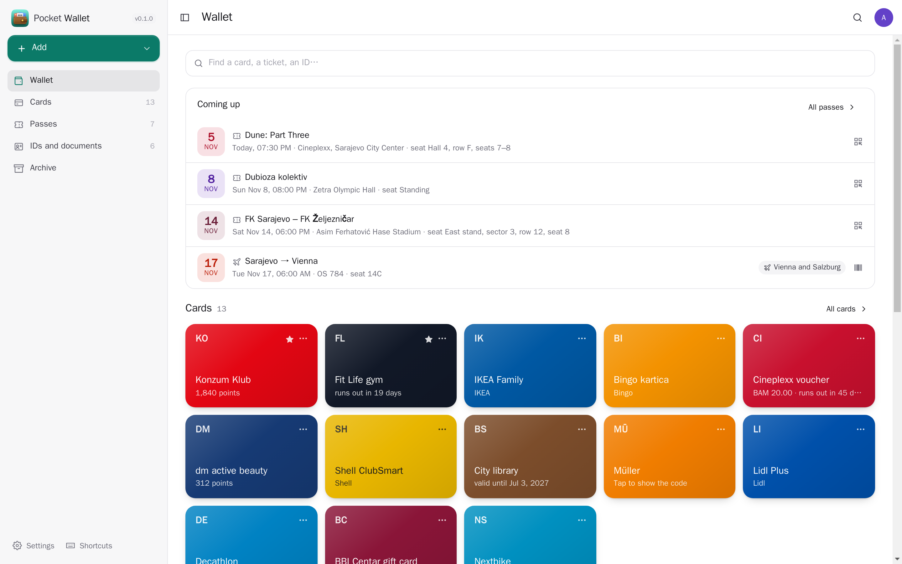
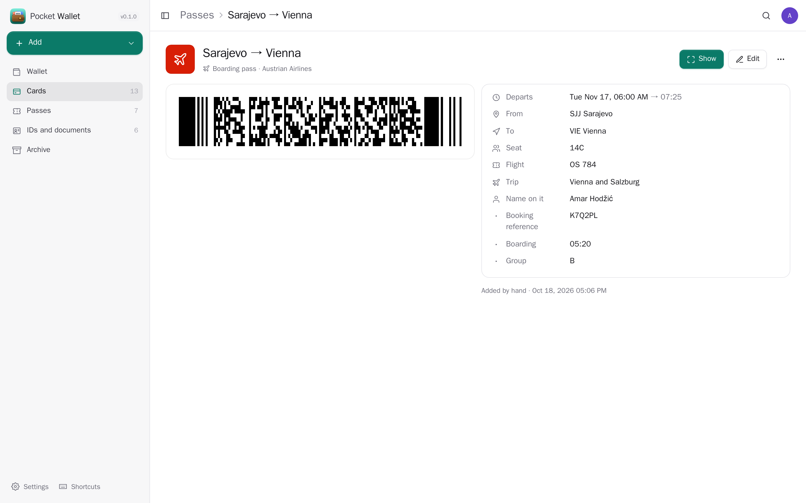
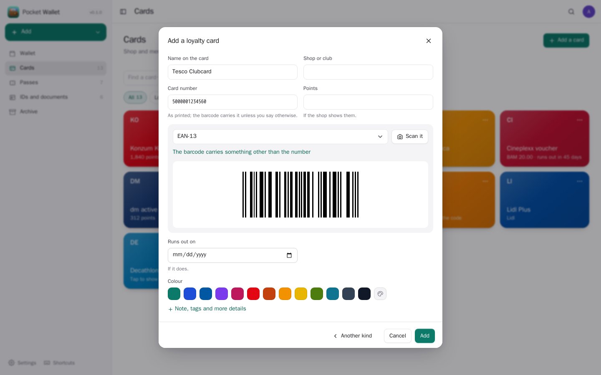
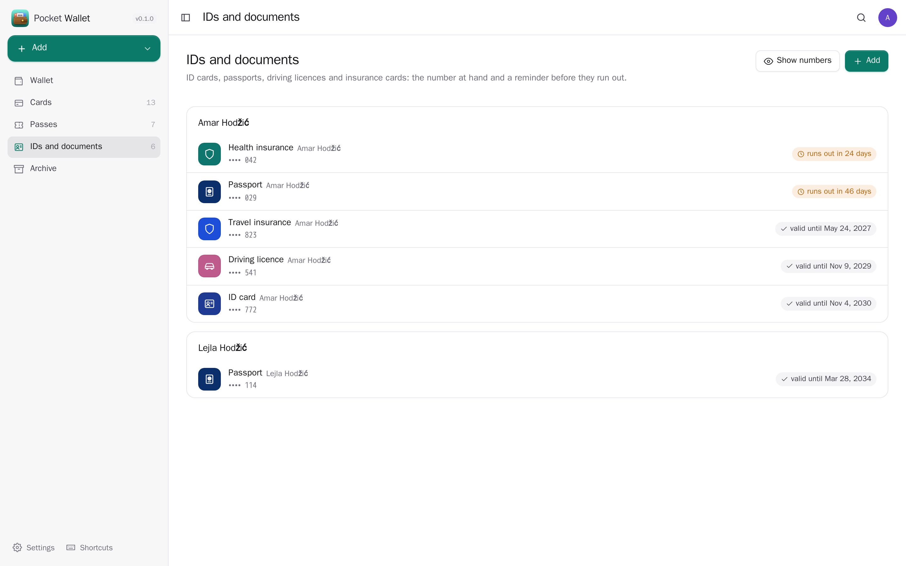
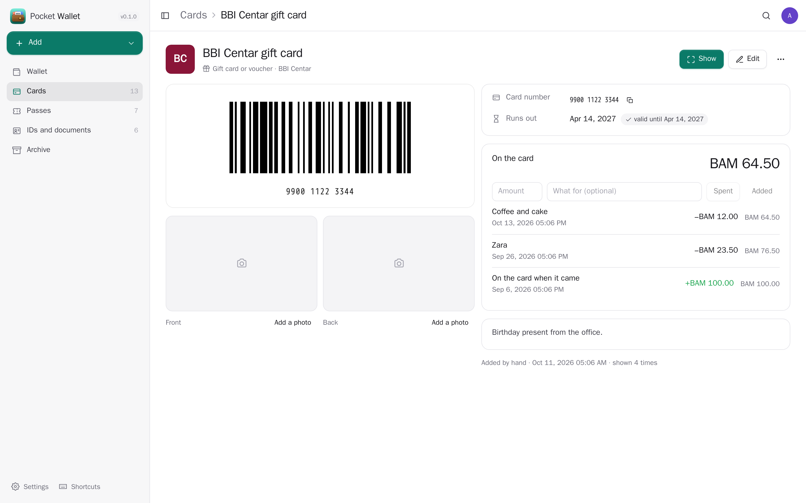
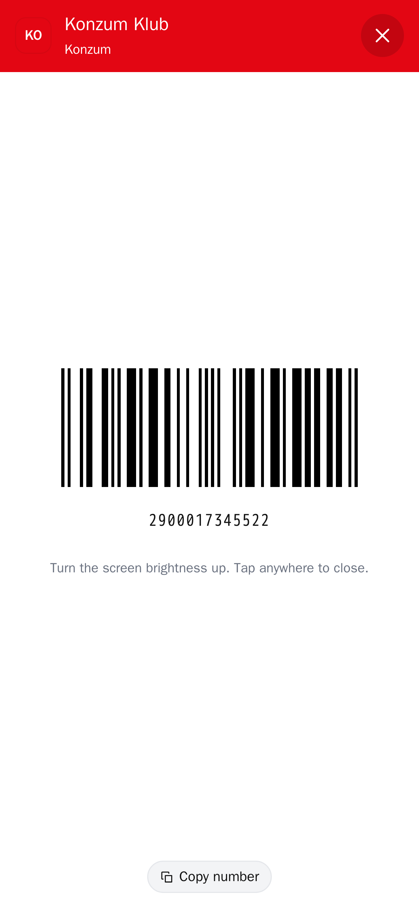
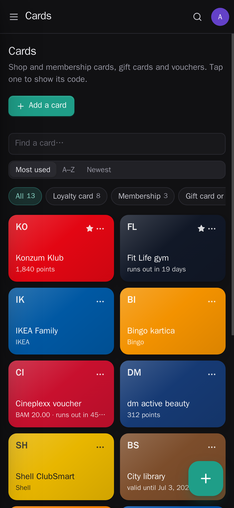

<p align="center"></p>
<h1 align="center">Pocket Wallet</h1>
<p align="center">Your loyalty and membership cards, gift cards, tickets, boarding passes and ID papers on your own server, ready to scan: tap a card and its barcode fills the screen for the till or the gate. Add a shop card by pointing the camera at it, bring passes in from .pkpass files (also straight from your email), move in from Catima, and get a reminder before a passport or a gift card runs out. With Pocket Core connected, flights and tickets go on your calendar and with their trip.<br>One Go binary, one SQLite file, one volume. Part of the Pocket apps; works on its own too.</p>
<p align="center">
  <a href="https://github.com/abjelosevic88/pocket-homelab-wallet/actions"></a>
  <a href="https://github.com/abjelosevic88/pocket-homelab-wallet/pkgs/container/pocket-homelab-wallet"></a>
  <a href="LICENSE"></a>
</p>

---

<p align="center"></p>

<table>
  <tr>
    <td width="50%"></td>
    <td width="50%"></td>
  </tr>
  <tr>
    <td align="center"><sub>A boarding pass: the code, departure, seat, flight and the trip it belongs to.</sub></td>
    <td align="center"><sub>Adding a card: scan the barcode or type the number; the code is drawn as you go.</sub></td>
  </tr>
  <tr>
    <td width="50%"></td>
    <td width="50%"></td>
  </tr>
  <tr>
    <td align="center"><sub>ID papers per person, numbers hidden until you ask, with when each one runs out.</sub></td>
    <td align="center"><sub>Gift cards keep what is left and what you spent.</sub></td>
  </tr>
  <tr>
    <td width="50%"></td>
    <td width="50%"></td>
  </tr>
  <tr>
    <td align="center"><sub>One tap: the code full screen on white, the screen kept awake.</sub></td>
    <td align="center"><sub>Made for the phone; light and dark follow the system.</sub></td>
  </tr>
</table>

## What it does

- **Cards for the till**: loyalty and membership cards, gift cards and vouchers, each with its colour, number, points and barcode. The ones you use most come first; pin your favourites.
- **Every barcode a card or ticket uses**: QR, Code 128, EAN-13/8, UPC-A/E, Code 39/93, ITF, Codabar, Aztec, PDF417 and Data Matrix, drawn on the server as crisp SVG.
- **Scan it in**: the camera reads the code (the browser's own reader where there is one, else the server reads the frames, so it works on an iPhone too), or a photo of the card.
- **Tickets and boarding passes**: when and where, seat, gate, flight or booking number, sorted by day. "Your pass is ready" arrives a while before it starts and opens it full screen.
- **.pkpass passes**: Apple Wallet files from airlines, trains, venues and shops come in with their barcode, times, seat, gate, colour and logo; the same pass sent again (a new gate) updates the card. With Pocket Email they are picked up from your email by themselves.
- **Paste the booking email**: AI fills in a pass from a confirmation email you paste; only that text is sent.
- **ID papers**: ID card, passport, driving licence, insurance cards with their number (hidden until you tap), photos of front and back, and reminders before they run out — a month, a week, a day before.
- **Gift cards** keep what is left: "spent 23.50" or "added 50" with a note.
- **Move in from Catima** (its export zip: cards, barcodes, colours, groups, balances, photos), from a CSV (Catima's and Stocard's column names work too), or a Pocket Wallet export. Importing twice adds nothing.
- **Everyone their own**: each person has their own wallet, settings and connections; admins see no one else's.
- **Export** as JSON with the photos (and back in) or as CSV; a whole-database backup for admins.

## Run it

```sh
docker run -d --name pocket-wallet -p 8080:8080 -v ./data:/data \
  -e BASE_URL=https://wallet.example.com -e SECURE_COOKIES=true \
  ghcr.io/abjelosevic88/pocket-homelab-wallet:latest
```

or `docker compose up -d` with [docker-compose.yml](docker-compose.yml). Open it, create the first account and scan a card. The camera needs HTTPS (or localhost). All options: [docs/configuration.md](docs/configuration.md). API: [docs/api.md](docs/api.md).

## With Pocket Core

Set `CORE_URL` and `CORE_REGISTRATION_KEY` and Wallet joins the box: people sign in with Pocket Core, and through app links each person's wallet reaches their own Pocket apps with nothing to paste:

| App | What Wallet does there | Scopes |
|---|---|---|
| Pocket Travel | files a pass with the trip it falls in; the pass shows its trip | `trips:read` |
| Pocket Calendar | a ticket or flight as an event with the place, seat and a link to the pass; moved when the gate or time changes | `calendar:read`, `calendar:write` |
| Pocket Email | adds the .pkpass files that arrive by email, every two hours | `mail:read` |
| Pocket Money | a loyalty card shows what you spent at that shop in the last 90 days | `transactions:read` |
| Pocket AI | reads a pasted booking email into a pass; the Ask button on every page | inference |

Other apps can read your wallet (`wallet:read`: a trip's boarding passes in Pocket Travel, the day's tickets in Pocket Day's journal, passports and cards that run out in Pocket Renewals, "what's my seat?" in Pocket AI) or add for you (`wallet:write`: a card, a pass, a .pkpass, spending from a gift card; it may change only what it added). Events on the bus: `wallet.card_saved`, `wallet.card_removed`, `wallet.pass_today`, `wallet.pass_soon`, `wallet.expiring` — never with a document number in them. Without Core every connection can be made directly with a URL and a token; the Core-only choices stay visible, greyed out.

## Develop

```sh
make dev     # API on :8080 with demo data + Vite on :5173
make test    # go vet, go test, tsc
make         # web + binary
```

MIT licensed. Barcodes drawn with [boombuler/barcode](https://github.com/boombuler/barcode) and read with [gozxing](https://github.com/makiuchi-d/gozxing).
